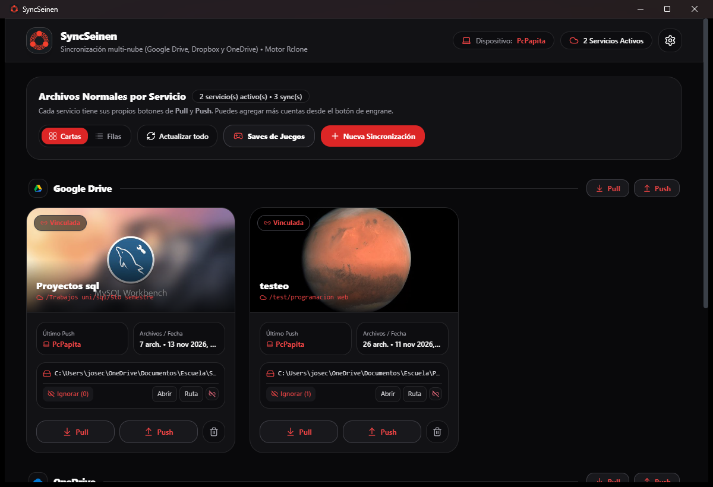
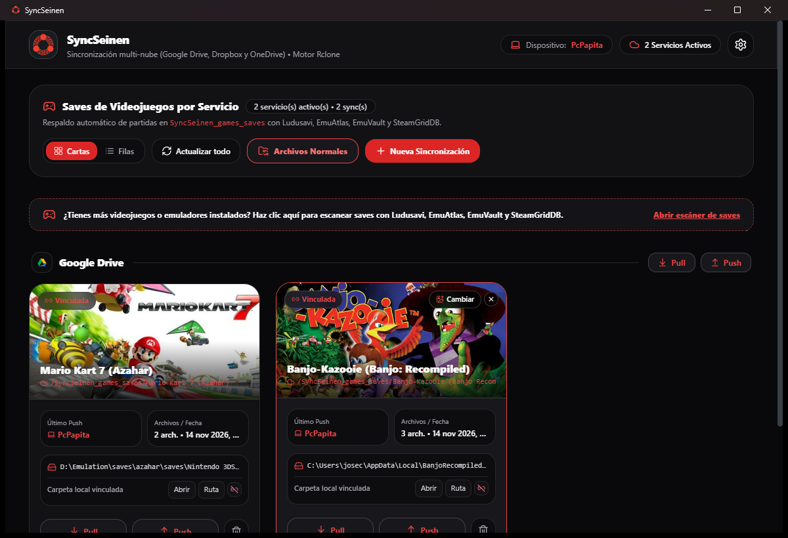
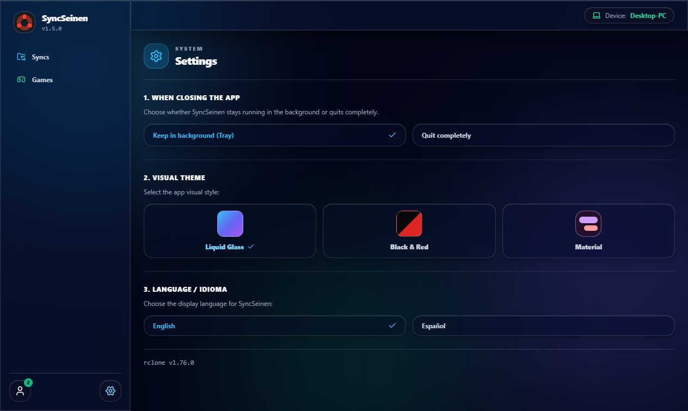

# 🔄 SyncSeinen

🌐 [English](README.md) | **Español**

**SyncSeinen** es una aplicación de escritorio diseñada para sincronizar carpetas y partidas guardadas de videojuegos (PC y emuladores) de forma sencilla, rápida y controlada entre múltiples dispositivos utilizando **Google Drive**, **Dropbox** y **OneDrive** mediante el motor **rclone** integrado.

> 🎮 **¿Buscas soporte para Steam Deck / SteamOS?**
> Visita el plugin compañero para Decky Loader: [**Deck-Seinen (Steam Deck)**](https://github.com/Mrpapita2124/Deck-Seinen).
> Ambos comparten exactamente el mismo formato de metadatos (`_SyncSeinen_Metadata`) y carpeta de partidas (`SyncSeinen_games_saves`), para sincronizar tus saves entre tu PC y tu Steam Deck de forma transparente.

---

## 📸 Capturas de Pantalla

### Panel Principal (Archivos Normales por Servicio)


### Apartado de Saves de Videojuegos y Emuladores


### Menú Sobrepuesto de Configuración y Servicios en la Nube


---

## ✨ Características Principales

- 🎮 **Sincronización Dedicada de Saves de Videojuegos y Emuladores (`SyncSeinen_games_saves`):**
  - **División en 2 apartados:** Alterna fácilmente entre **Regular Files / Archivos Normales** y **Game Saves / Saves de Juegos** desde el botón dedicado junto a **+ New Sync** (ambos con vista de **Cartas** o **Filas** y agrupados por servicio).
  - **Escáner Automático con Ludusavi Manifest, EmuAtlas y EmuVault:** Detecta partidas guardadas de videojuegos de PC y emuladores (**Eden**, **Yuzu**, **Ryujinx**, **Cemu**, **Azahar/Citra**, **Dolphin**, **RetroArch**, **PCSX2**, **DuckStation**, **PPSSPP**, **RPCS3**, **mGBA**, **melonDS**, **Snes9x**), ignorando silenciosamente archivos de otros juegos que compartan la misma carpeta.
  - **Carátulas Automáticas con SteamGridDB:** Asigna portadas oficiales automáticamente a cada juego o emulador detectado.
  - **Detección Automática en Otros Dispositivos y Prioridad de Pull:** Al iniciar sesión en otra PC, **SyncSeinen** busca automáticamente las rutas locales compatibles para tus saves sin vincular y coloca primero las sincronizaciones **Pendientes de Pull** cuyo último `Push` provenga de otro dispositivo.
  - **Carpeta automática en la nube para videojuegos:** Al marcar una sincronización manual como videojuego, se guarda automáticamente en `/SyncSeinen_games_saves/<nombre>` sin necesidad de elegir carpeta manual.

- ☁️ **Soporte Multi-Nube (`Google Drive`, `Dropbox` y `OneDrive`):**
  - Vincula una, dos o las tres nubes al mismo tiempo desde la pantalla inicial o desde el menú de configuración.
  - Cabeceras limpias por servicio (`(icono) Servicio -------- Pull · Push`) para ejecutar **Pull** o **Push** sobre todas las carpetas de ese servicio de manera independiente.

- ⚙️ **Menú de Configuración Sobrepuesto (Estilo Pausa):**
  - **Servicios en la nube en vista de filas:** Conecta o desconecta cuentas de **Google Drive**, **Dropbox** y **OneDrive** en cualquier momento.
  - **Selector de idioma (`English / Español`):** Cambia instantáneamente entre inglés (por defecto) y español.
  - **Selector visual de temas:** **Liquid Glass (Cristal Líquido)**, **Black & Red (Negro y Rojo)** y **Material** (Material 3 Expressive).
  - **Comportamiento al cerrar:** Elige entre minimizar a la bandeja del sistema o cerrarse por completo.
  - **Identificador de dispositivo:** Personaliza el nombre con el que esta PC registra cada **Push**.

- 🌐 **Buscador Integrado de Imágenes Online (DuckDuckGo Images) + Subida Local:**
  - Busca carátulas en internet mediante **DuckDuckGo Images** o sube una foto local; la portada se incrusta en `_SyncSeinen_Metadata` para que todos tus dispositivos vean la misma imagen.

- 🖥️ **Ejecución en Segundo Plano (*System Tray*) y Menú Rápido Tematizado:**
  - Desde el icono en la bandeja del sistema puedes abrir la app, hacer **Push** a todo, hacer **Pull** a todo o salir por completo.

- 🙈 **Exclusión Selectiva de Archivos y Carpetas (Ignorar en Push y Pull):**
  - Explorador visual integrado con botones **Marcar todos** y **Desmarcar todos** dentro de cada ruta para ignorar archivos o subcarpetas fácilmente.

- 🔔 **Actualizaciones Automáticas en Segundo Plano:**
  - Comprueba silenciosamente nuevas versiones en **GitHub Releases** y permite descargar, instalar y reiniciar con un clic (Windows Portable `.exe` y Linux `.AppImage`).

---

## 🆕 Novedades Recientes

- **v1.4.6:** Interfaz completa en inglés por defecto con selector de idioma en Configuración, y botones **Select all / Unselect all** (`Marcar todos / Desmarcar todos`) por ruta en el selector de archivos a ignorar.
- **v1.4.5:** Al marcar una sincronización como videojuego, la carpeta en la nube se fija automáticamente en `/SyncSeinen_games_saves/<nombre>`.
- **v1.4.4:** Permite seleccionar archivos a ignorar también en sincronizaciones manuales marcadas como videojuego.
- **v1.4.3:** Actualizador multiplataforma unificado con `SyncSeinen-Portable.exe` (Windows) y `SyncSeinen-Linux.AppImage` (Linux).

---

## 📦 Descarga e Instalación (Releases)

En [**Releases**](https://github.com/Mrpapita2124/syncseinen/releases) encontrarás las versiones listas para usar:

1. **`SyncSeinen-Portable.exe` (Windows 64 bits):** Ejecutable portable en un solo archivo, sin instalación.
2. **`SyncSeinen-Linux.AppImage` (Linux 64 bits):** AppImage portable (`chmod +x SyncSeinen-Linux.AppImage && ./SyncSeinen-Linux.AppImage`).

---

## 🛠️ Desarrollo y Compilación desde Código Fuente

```bash
git clone https://github.com/Mrpapita2124/syncseinen.git
cd syncseinen
npm install
npm run dev
```

- **Compilar Windows:** `npm run build:win`
- **Compilar Linux (`AppImage`):** `npm run build:linux`

---

## 🔒 Privacidad y Seguridad

- Tus credenciales (`rclone.conf`) y mapeos locales (`syncseinen-config.json`) se almacenan exclusivamente en tu equipo (`%APPDATA%\sync-seinen` en Windows o `~/.config/sync-seinen` en Linux).
- Ningún token ni dato personal se guarda dentro del repositorio.
