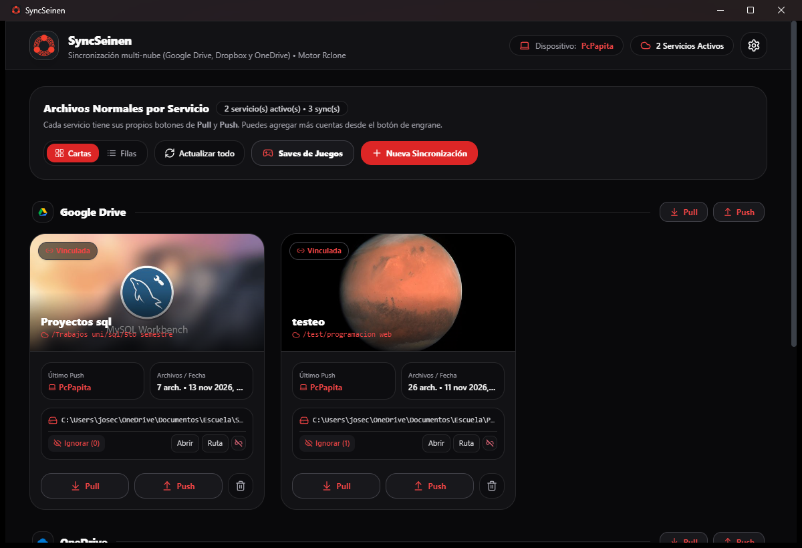
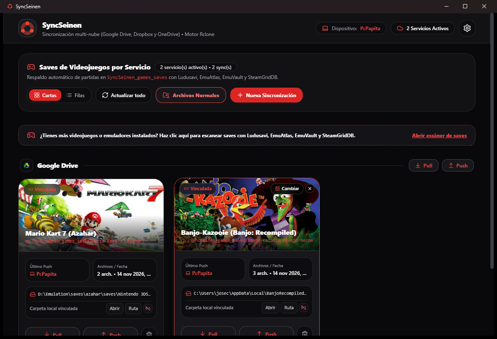

# 🔄 SyncSeinen

🌐 **English** | [Español](README.es.md)

**SyncSeinen** is a desktop application for Windows and Linux designed to synchronize folders and game saves (PC and emulators) simply, quickly, and reliably across multiple devices using **Google Drive**, **Dropbox**, and **OneDrive** powered by the built-in **rclone** engine.

> 🎮 **Looking for Steam Deck / SteamOS support?**
> Check out the companion Decky Loader plugin: [**Deck-Seinen (Steam Deck)**](https://github.com/Mrpapita2124/Deck-Seinen).
> Both apps share the exact same metadata format (`_SyncSeinen_Metadata`) and game saves folder (`SyncSeinen_games_saves`), so you can seamlessly sync saves between your PC and your Steam Deck.

---

## 📸 Screenshots

### Main Dashboard (Regular Files by Service)


### Game & Emulator Saves Section


### Settings & Cloud Services Overlay Menu


---

## ✨ Key Features

- 🎮 **Dedicated Game & Emulator Save Sync (`SyncSeinen_games_saves`):**
  - **2-section layout:** Easily switch between **Regular Files** and **Game Saves** using the button next to **+ New Sync** (both supporting **Cards** or **Rows** views grouped by cloud service).
  - **Automatic Scanner with Ludusavi Manifest, EmuAtlas & EmuVault:** Detects PC game saves and emulator saves (**Eden**, **Yuzu**, **Ryujinx**, **Cemu**, **Azahar/Citra**, **Dolphin**, **RetroArch**, **PCSX2**, **DuckStation**, **PPSSPP**, **RPCS3**, **mGBA**, **melonDS**, **Snes9x**), automatically ignoring unrelated files in shared folders.
  - **Automatic Covers with SteamGridDB:** Automatically assigns official artwork to every detected game or emulator.
  - **Automatic Path Detection & Pending Pull Priority:** When signing in on another PC, **SyncSeinen** automatically locates compatible local save paths for unlinked saves (showing **Auto sync** + **Manual** fallback) and prioritizes **Pending Pull** items whose last `Push` came from another device.
  - **Automatic Cloud Folder for Games:** When creating a manual sync marked as a game, the cloud destination is automatically locked to `/SyncSeinen_games_saves/<name>`.

- ☁️ **Multi-Cloud Support (**`Google Drive`**, **`Dropbox`**, and **`OneDrive`**):**
  - Link one, two, or all three cloud services at once from the onboarding screen or the Settings menu.
  - Each service section has its own header (`(icon) Service -------- Pull · Push`) to **Pull** or **Push** all linked folders in that provider independently.

- ⚙️ **Pause-Style Settings Overlay Menu:**
  - Click the **gear** button at the top right to open the centered settings overlay:
    - **Linked Cloud Services:** Sign in or disconnect **Google Drive**, **Dropbox**, and **OneDrive** at any time.
    - **Language / Idioma:** Switch instantly between **English** (default) and **Español**.
    - **Visual Theme Selector:** Choose between **Liquid Glass**, **Black & Red**, and **Material** (Material 3 Expressive).
    - **Close Behavior:** Choose whether closing the window minimizes to the system tray or quits completely.
    - **Device Name:** Customize the device name recorded on each **Push**.

- 🌐 **Built-in Online Cover Search (DuckDuckGo Images) + Local Upload:**
  - Search covers online via **DuckDuckGo Images** or upload a local image file. Covers are embedded in `_SyncSeinen_Metadata` so all your devices display the same artwork automatically.

- 🖥️ **Background System Tray & Themed Quick Menu:**
  - Click the **SyncSeinen** tray icon to **Open app**, **Push all**, **Pull all**, or **Quit**.

- 🙈 **Selective File & Folder Exclusion (Ignore on Push & Pull):**
  - Built-in file explorer to pick files or subfolders to exclude, now with **Select all** and **Unselect all** buttons inside every folder.
  - Ignored items are excluded from **Push** and left untouched on **Pull**.

- 🔔 **Automatic Background Updates:**
  - On launch, **SyncSeinen** checks **GitHub Releases** in the background and lets you download, install, and restart with one click (supports both Windows Portable `.exe` and Linux `.AppImage`).

---

## 🆕 What's New in v1.4.6

- **English UI by default + Language Switcher:** Full English interface with an **English / Español** toggle in **Settings**.
- **Select all / Unselect all in Ignore Files:** Quickly mark or unmark all items in the current folder when choosing ignored paths.
- **Automatic game folder (`v1.4.5`):** Syncs marked as games automatically use `/SyncSeinen_games_saves/<name>` without manual folder selection.
- **Ignore files on manual game syncs (`v1.4.4`):** You can now configure ignored files even when creating a manual sync marked as a game.
- **Unified cross-platform updater (`v1.4.3`):** Releases include both `SyncSeinen-Portable.exe` (Windows) and `SyncSeinen-Linux.AppImage` (Linux).

---

## 🔄 Workflow

1. **Link your cloud services:** Sign in to **Google Drive**, **Dropbox**, and/or **OneDrive**.
2. **Create a sync on Device 1:** Choose a service, set a name, pick a cover (online or local), select your local folder, choose/create the cloud folder (automatic for games), and optionally exclude files.
3. **Detect syncs on Device 2:** Sign in with the same accounts on another PC or Steam Deck (**Deck-Seinen**); `_SyncSeinen_Metadata` is read automatically.
4. **Continuous sync (`Pull` & `Push`):** Sync per folder, per service, or all at once from the tray menu.

---

## 📦 Download & Installation (Releases)

On the [**Releases**](https://github.com/Mrpapita2124/syncseinen/releases) page you will find ready-to-use binaries:

1. **`SyncSeinen-Portable.exe` (Windows x64):** Single-file portable executable — just run it, no installation required.
2. **`SyncSeinen-Linux.AppImage` (Linux x64):** Portable AppImage (`chmod +x SyncSeinen-Linux.AppImage && ./SyncSeinen-Linux.AppImage`).

---

## 🛠️ Development & Building from Source

### Prerequisites
- [Node.js](https://nodejs.org/) (v18+)
- Git

### 1. Clone and install dependencies
```bash
git clone https://github.com/Mrpapita2124/syncseinen.git
cd syncseinen
npm install
```

### 2. Run in development mode
```bash
npm run dev
```

### 3. Build executables
- **Windows (Portable `.exe`):**
  ```bash
  npm run build:win
  ```
- **Linux (`AppImage`):**
  ```bash
  npm run build:linux
  ```

---

## 🔒 Privacy & Security

- Your session tokens (`rclone.conf`) and local path mappings (`syncseinen-config.json`) are stored strictly locally in your OS user data directory (`%APPDATA%\sync-seinen` on Windows or `~/.config/sync-seinen` on Linux).
- No tokens or personal data are ever stored in the repository.
