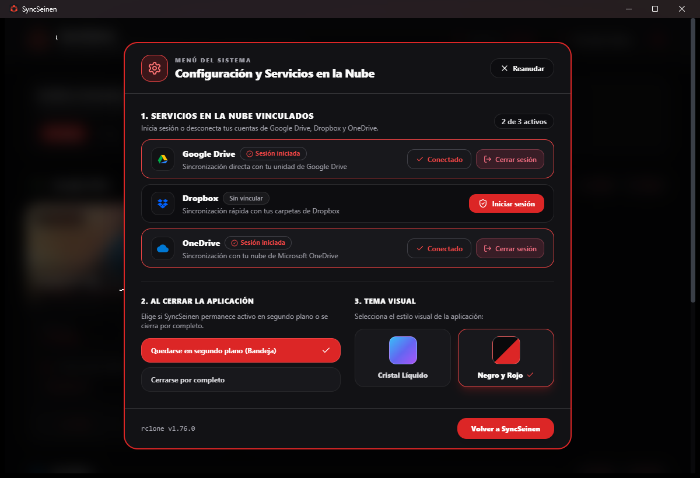

# 🔄 SyncSeinen

**SyncSeinen** es una aplicación de escritorio diseñada para sincronizar carpetas y partidas guardadas de videojuegos (PC y emuladores) de forma sencilla, rápida y controlada entre múltiples dispositivos utilizando **Google Drive**, **Dropbox** y **OneDrive** mediante el motor **rclone** integrado.

---

## 📸 Capturas de Pantalla

### Panel Principal (Archivos Normales por Servicio)


### Apartado de Saves de Videojuegos y Emuladores


### Menú Sobrepuesto de Configuración y Servicios en la Nube


---

## ✨ Características Principales

- 🎮 **Sincronización Dedicada de Saves de Videojuegos y Emuladores (`SyncSeinen_games_saves`):**
  - **División en 2 apartados:** Alterna fácilmente entre **Archivos Normales** y **Saves de Juegos** desde el botón dedicado junto a **+ Nueva Sincronización** (ambos con vista de **Cartas** o **Filas** y agrupados por servicio).
  - **Escáner Automático con Ludusavi Manifest, EmuAtlas y EmuVault:** Detecta partidas guardadas de videojuegos de PC y emuladores (**Eden**, **Yuzu**, **Ryujinx**, **Cemu**, **Azahar/Citra**, **Dolphin**, **RetroArch**, **PCSX2**, **DuckStation**, **PPSSPP**, **RPCS3**, **mGBA**, **melonDS**, **Snes9x**), ignorando silenciosamente archivos de otros juegos que compartan la misma carpeta.
  - **Carátulas Automáticas con SteamGridDB:** Asigna portadas oficiales automáticamente a cada juego o emulador detectado.
  - **Detección Automática en Otros Dispositivos y Prioridad de Pull:** Al iniciar sesión en otra PC, **SyncSeinen** busca automáticamente las rutas locales compatibles para tus saves sin vincular (mostrando un botón de **Sincronizar automático** y una opción **Manual** al lado, o pidiendo ingresar/examinar la ruta si no existe) y coloca primero las sincronizaciones **Pendientes de Pull** cuyo último `Push` provenga de otro dispositivo.

- ☁️ **Soporte Multi-Nube (**`Google Drive`**, **`Dropbox`** y **`OneDrive`**):**
  - Vincula una, dos o las tres nubes al mismo tiempo desde la pantalla inicial o desde el menú de configuración.
  - Al iniciar sesión en un servicio, éste queda marcado como **Sesión iniciada**, permitiéndote seguir vinculando otros servicios antes de pasar al panel o continuar con al menos un servicio activo.
  - La vista principal divide las sincronizaciones por proveedor con una cabecera limpia en línea (`(icono) Servicio -------- Pull · Push`) para ejecutar **Pull** o **Push** sobre todas las carpetas de ese servicio de manera independiente.
- 🎮 **Menú de Configuración Sobrepuesto (Estilo Pausa):**
  - Al pulsar el botón de **engrane** arriba a la derecha se despliega un menú sobrepuesto centrado sobre la pantalla:
    - **Servicios en la nube en vista de filas:** Conecta o desconecta cuentas de **Google Drive**, **Dropbox** y **OneDrive** en cualquier momento.
    - **Selector visual de temas con muestras de color:** Botones dedicados que muestran los colores de cada tema (**Cristal Líquido** con degradado azul/morado y **Negro y Rojo** con cuadrado dividido diagonalmente en dos triángulos rectángulos negro y rojo).
    - **Comportamiento al cerrar la ventana:** Elige entre minimizarse a la bandeja del sistema o cerrarse por completo.
    - **Identificador de dispositivo:** Personaliza el nombre con el que esta PC registra cada **Push**.
- 🎨 **Dos Temas Visuales (**`Cristal Líquido`** y **`Negro y Rojo Plano`**):**
  - **Cristal Líquido:** Diseño translúcido con efectos de refracción y luces ambientales en tonos azules y morados.
  - **Negro y Rojo Plano:** Estética de colores sólidos planos en negro mate (`#09090b` / `#121215`) y acentos en rojo intenso (`#dc2626` / `#ef4444`).
- 🌐 **Buscador Integrado de Imágenes Online (DuckDuckGo Images) + Subida Local:**
  - Al agregar o cambiar la carátula de cualquier sincronización, se abre un mini buscador de imágenes en internet mediante **DuckDuckGo Images**; basta con escribir el nombre para seleccionar una imagen al instante o pulsar **Subir foto local**.
  - La carátula se optimiza e incrusta dentro de `_SyncSeinen_Metadata` en la nube correspondiente, por lo que **todos tus dispositivos ven la misma portada automáticamente**.
- 🖥️ **Ejecución en Segundo Plano (*System Tray*) y Menú Rápido Tematizado:**
  - Al hacer clic sobre el icono de **SyncSeinen** en la bandeja del sistema se despliega un menú rápido tematizado con las opciones:
    - **Abrir la aplicación**
    - **Hacer push a todo**
    - **Hacer pull a todo**
    - **Cerrarla por completo**
- 📁 **Creación Automática de Subcarpeta con el Nombre de tu Carpeta Local:**
  - Al elegir la ruta destino en tu nube (**Google Drive**, **Dropbox** o **OneDrive**), puedes crear y añadir automáticamente una subcarpeta con el mismo nombre de la carpeta seleccionada en tu PC con un solo clic.
- 🙈 **Exclusión Selectiva de Archivos y Carpetas (Ignorar en Push y Pull):**
  - Explorador visual integrado para seleccionar qué archivos o subcarpetas no deseas sincronizar.
  - Los elementos marcados como ignorados no se suben durante el **Push** ni se sobrescriben o eliminan durante el **Pull** (su existencia local se respeta intacta).
- 🔔 **Actualizaciones Automáticas en Segundo Plano:**
  - Al iniciar la aplicación, **SyncSeinen** comprueba silenciosamente en segundo plano si existe una nueva versión en **GitHub Releases** y permite descargar, instalar y reiniciar automáticamente con un solo clic.

---

## 🆕 Novedades de la Versión 1.4.0

- **Apartado Dedicado de Saves de Videojuegos y Emuladores:**
  - Botón para cambiar entre **Archivos Normales** y **Saves de Juegos** junto a **+ Nueva Sincronización**, conservando la división por servicio y los modos de vista (**Cartas** y **Filas**).
  - Nueva casilla **Es una sincronización de save de videojuego** en el modal de **+ Nueva Sincronización** para juegos no detectados automáticamente.
- **Escáner Estilo Pausa con Ludusavi Manifest + SteamGridDB:**
  - Al entrar al apartado de **Saves de Juegos** vacío (o desde su barra superior), se abre el menú sobrepuesto de escaneo con buscador de texto, filtros por origen (**Todos**, **PC • Ludusavi**, **Emuladores • EmuAtlas & EmuVault**) y selección múltiple.
  - En el **Paso 2**, elige el servicio en la nube por juego y pulsa **Finalizar y sincronizar** para subir todos los seleccionados en lote dentro de `/SyncSeinen_games_saves/<Juego>`, ignorando silenciosamente archivos ajenos en carpetas compartidas.
- **Compatibilidad con Emuladores mediante EmuAtlas y EmuVault:**
  - Detección automática de raíces de emulación y saves de **Eden / Yuzu / Suyu / Sudachi / Citron**, **Ryujinx**, **Cemu** (leyendo `meta.xml`), **Azahar / Citra / Lime3DS** (cabeceras NCSD), **Dolphin**, **RetroArch**, **PCSX2**, **DuckStation**, **PPSSPP**, **RPCS3** (`PARAM.SFO`), **mGBA**, **melonDS** y **Snes9x**.
- **Auto-detección de Rutas en Otro Dispositivo y Prioridad de Pull Pendiente:**
  - Al iniciar sesión en otra computadora, **SyncSeinen** escanea automáticamente dónde guardar cada save de juego o emulador pendiente: si encuentra la ruta, muestra **Sincronizar automático (Pull)** + botón **Manual**; si no la encuentra, permite ingresarla o seleccionarla desde la PC.
  - Las sincronizaciones cuyo último `Push` fue realizado desde otro dispositivo se marcan como **Pendiente de Pull** y aparecen automáticamente al inicio (en cuadrícula) o hasta arriba (en filas).

---

## 🕓 Historial de Versiones Recientes

### Versión 1.3.0
- **Compatibilidad con Dropbox y Microsoft OneDrive (además de Google Drive):**
  - Soporte completo para crear, vincular, listar carpetas, ignorar rutas y sincronizar (`Push` / `Pull`) en **Google Drive**, **Dropbox** y **OneDrive**.
  - Resolución automática de unidades en **OneDrive Personal** (descartando unidades fantasma `b!...` de la *Bóveda Personal / Personal Vault* y excluyendo automáticamente carpetas protegidas).
  - Flujo de autenticación OAuth no interactivo con **rclone** que abre una única pestaña en el navegador y limpia configuraciones parciales si se cancela.
- **Pantalla Inicial Multi-Servicio y Menú Sobrepuesto (Tipo Pausa)** con selector visual de temas y vista de filas de servicios.
- **Cabeceras de Servicio Limpias** (`(icono) Servicio -------- Pull · Push`).

### Versión 1.2.0
- **Mini Buscador de Carátulas Online (DuckDuckGo Images)** y subida local.
- **Modo en Segundo Plano (*System Tray*) con Menú Rápido Tematizado**.
- **Nuevo Tema `Negro y Rojo Plano`** e icono oficial `SyncSeinen`.
- **Subcarpeta Automática** con el nombre de la carpeta local de la PC.

---

## 🔄 Flujo de Trabajo

1. **Vincula tus servicios en la nube:**
   - Inicia sesión en **Google Drive**, **Dropbox** y/o **OneDrive**. Puedes agregar más servicios en cualquier momento desde el menú de configuración (engrane).
2. **Dispositivo 1 crea la sincronización:**
   - Eliges en qué servicio en la nube guardarla, asignas un nombre, buscas una carátula online (o subes una local), seleccionas la carpeta local en tu computadora, escoges (o creas automáticamente) la carpeta destino en la nube y opcionalmente marcas archivos a ignorar.
   - Al confirmar, **SyncSeinen** sube los archivos y registra la metadata en `_SyncSeinen_Metadata` dentro de ese servicio.
3. **Dispositivo 2 detecta las sincronizaciones:**
   - Al iniciar sesión con las mismas cuentas en otro dispositivo, la aplicación lee automáticamente `_SyncSeinen_Metadata` de cada nube conectada y agrupa las sincronizaciones por servicio.
4. **Sincronización continua (`Pull` y `Push`):**
   - Ejecuta **Pull** o **Push** por carpeta individual, por servicio completo (desde la cabecera de cada nube) o para todos los servicios desde el menú rápido de la bandeja del sistema.

---

## 📦 Descarga e Instalación (Releases)

En la sección de [**Releases**](https://github.com/Mrpapita2124/syncseinen/releases) encontrarás dos versiones listas para usar en Windows (64 bits):

1. **`SyncSeinen-Portable.exe`:** Ejecutable portable en un solo archivo. Solo ábrelo para iniciar el programa sin instalar nada.
2. **`SyncSeinen-win-x64.zip`:** Versión comprimida desempaquetada (arranque instantáneo al descomprimir y ejecutar `SyncSeinen.exe`).

---

## 🛠️ Desarrollo y Compilación desde Código Fuente

### Requisitos previos
- [Node.js](https://nodejs.org/) (v18 o superior)
- Git

### 1. Clonar el repositorio e instalar dependencias
```bash
git clone https://github.com/Mrpapita2124/syncseinen.git
cd syncseinen
npm install
```

### 2. Ejecutar en modo desarrollo
```bash
npm run dev
```

### 3. Compilar ejecutables
- **En Windows (Portable `.exe` y carpeta desempaquetada):**
  ```bash
  npm run build:win
  ```
- **En Linux (`AppImage`):**
  ```bash
  npm run build:linux
  ```

---

## 🔒 Privacidad y Seguridad

- Tus credenciales y tokens de sesión (`rclone.conf`) y el mapeo de rutas locales (`syncseinen-config.json`) se almacenan exclusivamente de forma local en el directorio de datos de usuario de tu sistema operativo (`%APPDATA%\sync-seinen` en Windows o `~/.config/sync-seinen` en Linux).
- Ningún token ni dato personal se guarda dentro del repositorio.
